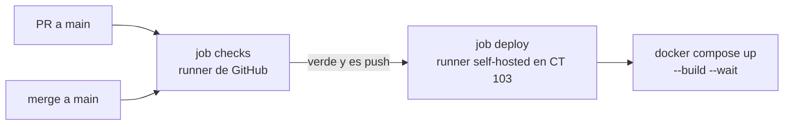

# Plan: la API dentro de Next.js y despliegue en el home lab

Ramas: `refactor/api-into-nextjs` (fase 1, sale de `develop`) y `feature/dockerize` (fase 2, sigue a la anterior).

## Qué es

`GaztaindiGrill-API` existía solo porque el add-on Apache2 de Home Assistant servía ficheros
estáticos. La web pasa a correr como servidor Node en el CT 103 del home lab (Proxmox), así que el
CRUD de programas, categorías y usuarios se muda a Route Handlers de Next.js y la API de Python se
borra. MariaDB y Mosquitto se quedan en Home Assistant.

Después, el despliegue se automatiza: un merge a `main` comprueba la web en GitHub y, si pasa, un
runner self-hosted en el CT 103 construye la imagen Docker y sustituye el contenedor. Sin GHCR.

## Decisiones

### Rutas REST bajo `/api`

| FastAPI | Next.js |
|---|---|
| `GET /programs` | `GET /api/programs` |
| `POST /programs/create` | `POST /api/programs` |
| `GET /programs/{id}` | `GET /api/programs/[id]` |
| `PATCH /programs/{id}` | `PATCH /api/programs/[id]` |
| `DELETE /programs/{id}` | `DELETE /api/programs/[id]` |
| `GET /categories` | `GET /api/categories` |
| `POST /categories/create` | `POST /api/categories` |
| `GET /users` | `GET /api/users` |
| `POST /users/create` | `POST /api/users` |

Mismo origen que la página: el cliente llama a `/api/...` relativo, sin `apiBaseUrl()` ni CORS. Las
respuestas son **idénticas** a las de FastAPI (snake_case, mismos códigos y mensajes).

### Capa de datos: Drizzle ORM sobre `mysql2`

- Esquema en TypeScript (`src/db/schema.ts`), consultas tipadas, migraciones con `drizzle-kit`.
- `src/db/index.ts`: pool de `mysql2` con `import 'server-only'`, guardado en `globalThis` para el hot reload.
- `src/server/data/*.ts`: consultas. `src/server/validation/*.ts`: esquemas `zod`. `src/app/api/**/route.ts`: solo HTTP.
- **`steps_json` sale como string** (en MariaDB `JSON` es `LONGTEXT`; `parseSteps()` espera un string).
- **Fechas en ISO con `T`** (`2026-09-10T23:09:29`): Safari en iPad no parsea el formato con espacio.

### Config en runtime, no en el build

`DB_*` y `MQTT_*` son variables de servidor que el layout raíz lee al servir la página y pasa al
cliente. Nada de `NEXT_PUBLIC_*` para hosts: cambiar una IP no obliga a recompilar.

### Red

| Qué | Dónde |
|---|---|
| Web | CT 103, `http://192.168.1.103:3000`, HTTP (sin HTTPS, así que el broker va por `ws`) |
| MariaDB | HA, `192.168.1.102:3306`, base `gaztaindi_grill`, login `gaztaindi_grill` |
| Mosquitto | HA, `192.168.1.102`, WebSocket en `1884` |

### Despliegue: Docker Compose construido en el CT

- El job `deploy` corre en el runner del CT 103: `docker compose up -d --build --wait`
  con `IMAGE_TAG` = SHA del commit. `--wait` falla si el contenedor no llega a `healthy`
  (`HEALTHCHECK` del Dockerfile contra `/api/health`). Después etiqueta esa imagen como `latest`.
- Variables en `/etc/gaztaindigrill-web.env` (fuera del repo), vía `env_file`.
- Volver atrás: `IMAGE_TAG=<sha> docker compose ... up -d`; las imágenes de menos de 30 días se guardan.
- Por qué Docker y no Node + systemd: más limpio, sin script propio para cambiar de versión y
  comprobar la salud. Coste: el usuario del runner está en el grupo `docker` (equivale a root en el CT).
- Por qué sin GHCR: para una sola máquina, construir, subir y bajar una imagen no aporta nada
  frente a construirla en el CT.

## Fase 1: API dentro de Next.js (hecha, 12/10)

| # | Tarea | Commit |
|---|---|---|
| 1 | Capa de datos con Drizzle | `feat: add a typed database layer for the programs database` |
| 2 | Next.js como servidor (`standalone`, `/api/health`) | `feat: run the web client as a Node server in a Docker container` |
| 3 | Programas en `/api/programs` | `refactor: serve programs from the web's own api routes` |
| 4 | Categorías en `/api/categories` | `refactor: serve categories from the web's own api routes` |
| 5 | Usuarios en `/api/users` | `refactor: serve users from the web's own api routes` |
| 6 | Quitar `apiBaseUrl()` | `refactor: drop the separate api host from the web client` |
| 7 | Broker MQTT en runtime | `feat: read the broker address at runtime instead of baking it into the build` |
| 8 | Tarjeta de HA apunta a `192.168.1.103:3000/control` | `fix: point the home assistant dashboard card at the home lab` |
| 9 | Borrar `GaztaindiGrill-API` | `chore: remove the fastapi service now that the web serves its own api` |
| 10 | Herramientas de `.claude/` sin la API | `chore: drop the api project from the claude tooling` |

Manual pendiente en HA: desinstalar el add-on `gaztaindigrill_api` y, si nada más lo usa, Apache2.

## Fase 2: CI/CD (lo escribe el usuario; aquí solo el objetivo de cada tarea)

Escrito el 26/11 (lo picó Claude; Julen decide y revisa). Falta probarlo de verdad.

### 11. Job `checks` (runner de GitHub) — escrito
- `.github/workflows/web.yml`: `push` y `pull_request` hacia `main` que toquen `GaztaindiGrill-NextJS/**` o el workflow, y `workflow_dispatch`.
- `npm ci`, `lint`, `typecheck`, `build`, con caché de npm y Node desde `.nvmrc`.
- **Verificación:** un PR que toca la web sale en verde; con un error de tipos a propósito, en rojo.

### 12. Runner self-hosted en el CT 103 — falta
- Docker instalado, usuario `github-runner` en el grupo `docker`, runner como servicio con etiqueta `homelab`.
- `/etc/gaztaindigrill-web.env` con los valores reales. Pasos en `docs/deploy.md`.
- **Verificación:** «Idle» en Settings → Actions → Runners, también después de reiniciar el CT.

### 13. (quitada: era el servicio systemd, sustituido por Docker)

### 14. Job `deploy` (runner self-hosted) — escrito
- Solo con `push` a `main` o a mano en `main`; depende de `checks`; nunca dos a la vez.
- `compose.yml` construye y arranca; probado en local el 26/11 (llega a `healthy`).
- **Verificación:** mergear un cambio visible y verlo en la web sin entrar al CT; un PR sin mergear no lanza `deploy`.

### 15. Ruleset de `main`
- «Restrict deletions», «Block force pushes», «Require a pull request before merging» (0 aprobaciones), sin bypass.
- «Require status checks to pass» con el job `checks`, cuando haya corrido una vez.
- **Verificación:** un PR con `checks` en rojo no deja mergear.

### 16. Docs — hecho
- `docs/deploy.md` reescrito para este flujo (26/11).

## Seguridad (repo público + runner self-hosted)

- [ ] Ningún job con `runs-on: self-hosted` se dispara con `pull_request`, `pull_request_target` ni `issue_comment`.
- [ ] Settings → Actions → General → «Require approval for all external contributors».
- [ ] No aprobar PRs de fuera que toquen `.github/workflows/`.
- [ ] `/etc/gaztaindigrill-web.env` fuera del repo, permisos `640` (root:github-runner).
- [ ] El usuario del runner sin `sudo` (sí en el grupo `docker`: por eso lo de arriba es obligatorio).
