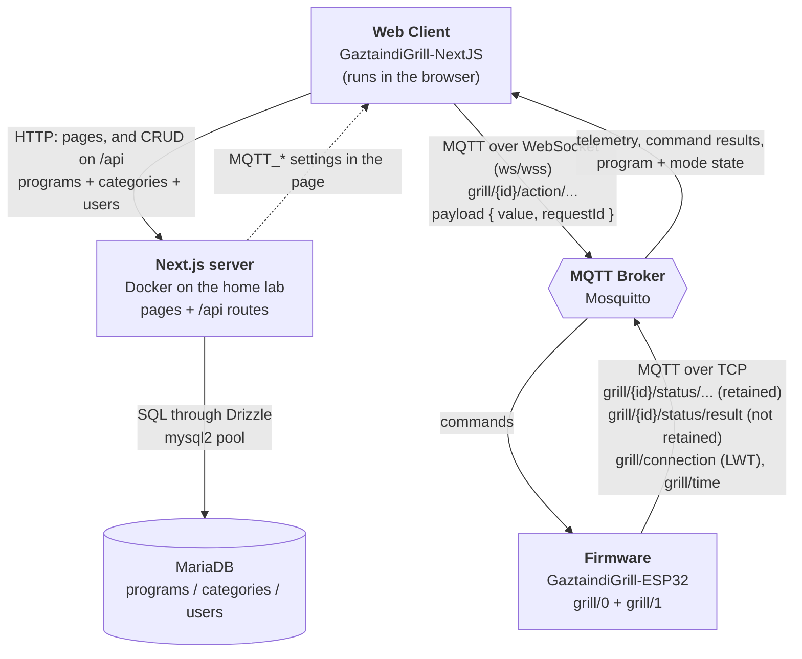

# CLAUDE.md

This file provides guidance to Claude Code (claude.ai/code) when working with code in this repository.

## Pendiente de probar en el caserío

**El ESP32 está flasheado desde el 03/10/2026, pero lo nuevo está sin probar en la parrilla.**
Qué probar, con `mosquitto_sub -v -t 'grill/#'` mirando:

1. **Pasos de temperatura en programas** (lo último, ver `.claude/plans/temperature-steps.md`):
   un programa `[{temperature: T}, {time: 600}]` con T por encima de la lectura actual baja la
   parrilla a pasos del 2 %, espera 10 s entre correcciones y termina el paso al entrar en T±5;
   durante la espera sigue corrigiendo. En la parrilla derecha, el mismo programa se rechaza con
   `no_sensor`. En la web sale la línea "Manteniendo T ±5°C" en el panel de ejecución.
2. **Ajustar el regulador si oscila:** las cifras son constantes en `GrillConstants.h`
   (`TEMPERATURE_*`). Orden de ajuste: subir `TEMPERATURE_SETTLE_MS`, bajar
   `TEMPERATURE_STEP_PCT`, y solo al final ampliar `TEMPERATURE_BAND`.
3. **Giro por el lado corto** (`a450bd7`): desde 0° pedir 200° debe ir por 359, 358, 357...
4. **`set_pose` y el suelo de seguridad** (`213dba8`, `d92f514`): con la rejilla a 90°,
   `set_position 0` para en el 60 %; `set_pose {40, 90}` desde el 20 % sube, gira y acaba en 60.
5. **Parar a mano un `set_pose`:** lanzarlo desde el modal, pararlo con el botón central de los
   controles a mitad de giro, y darle al punto 0 (botón azul). Antes daba `rotor_busy` para siempre.
6. **Girar hacia plano no sube:** con la rejilla a 20° y al 16 %, `set_rotation 0` gira sin mover
   la altura; de 0° a 90° desde el 20 % sigue subiendo al 60 %, y de 20° a 60° sube al 54 %.
7. **Editar un paso en marcha**: con un programa en una espera, cambiarla desde
   el lápiz de "Secuencia" en `/control`: la espera vuelve a empezar con lo que pongas (poner 10 s
   deja "Espera: 10s" y la cuenta atrás en 10) y el programa guardado en la API no cambia. Editar un paso futuro y ver que se ejecuta con el valor nuevo.

Cuando todo esté probado, borrar esta sección.

## What this repository is

**GaztaindiGrill** is a monorepo: a remotely-controlled grill (ESP32) driven over MQTT from a Next.js app that also serves the REST API persisting cooking programs. It holds every part of the ecosystem in one git history — firmware and web app. Each project below has its own CLAUDE.md with project-specific commands.

## Layout

| Path | Role | Stack |
|---|---|---|
| `GaztaindiGrill-ESP32/` | Firmware running on the ESP32 that physically drives the grill (vertical position, rotation/tilt, temperature, cooking programs). | C++ / Arduino framework / PlatformIO |
| `GaztaindiGrill-NextJS/` | Web app: the pages that control the grill in real time and manage programs, plus the REST API under `src/app/api/` (CRUD for programs, categories and users on MariaDB). | Next.js 15 / React 19 / TypeScript / Drizzle |

The FastAPI service `GaztaindiGrill-API/` and its Home Assistant add-on were removed once the web stopped being a static export: the API only existed apart because the HA Apache add-on could serve nothing but static files.

### Deploying the web

The web runs as a Docker container on a Proxmox LXC in the home lab, at `http://192.168.1.103:3000`.
MariaDB and Mosquitto stay as Home Assistant add-ons, reached over the LAN. `GaztaindiGrill-NextJS/docs/deploy.md`
is the whole runbook (LXC, Docker install, first deploy, updates, troubleshooting), in Spanish.

- `next.config.ts` sets `output: 'standalone'`; the multi-stage `Dockerfile` copies only `server.js`, the traced `node_modules` and the static files. `compose.yaml` starts it with `restart: unless-stopped` and the healthcheck hits `/api/health`.
- **Every setting is read by the server at runtime**, from `.env` next to `compose.yaml` on the server (`.env.local` in dev): `DB_*` for MariaDB and `MQTT_*` for the broker. None is `NEXT_PUBLIC_*`, so the image holds no host or credential and a change needs a restart, never a rebuild. The root layout calls `connection()` so pages render per request instead of freezing the build's environment.
- Deploying today is `git pull` + `docker compose up -d --build` on the LXC. Building on GitHub Actions and pulling the image from GHCR is planned for its own branch.
- Home Assistant's IP has come from DHCP and changed more than once; `DB_HOST` and `MQTT_HOST` break when it does, so give it a fixed one.

`GaztaindiGrill-NextJS/homeassistant/dashboard-card.yaml` is the HA dashboard view that embeds the web in an iframe (pasted into the dashboard by hand). Its URL names the home lab's fixed address, which the browser resolves, so it only works from the LAN.

## System architecture (cross-project)

- **HTTP** to `/api` is used *only* for CRUD on programs, categories and users, called from the browser on the page's own origin. The server is not in the real-time control loop.
- **MQTT** is used for *everything else*: manual movement/rotation commands, program execution, sensor telemetry, mode switching, and connection status (LWT). This happens directly between the browser and the ESP32 — the Next.js server does not relay these messages and holds no MQTT connection. It only tells the browser where the broker is: `MQTT_HOST` and the rest, read from its environment (`src/server/mqttConfig.ts`). An empty `MQTT_HOST` falls back to the host the page was served from.

## Source of truth for the MQTT contract

**`GaztaindiGrill-ESP32/lib/Grill/GrillConstants.h`** is the authoritative definition of every MQTT topic, payload string, error code and protocol constant. When implementing or debugging anything MQTT-related:

1. Check `GrillConstants.h` first.
2. Cross-check against `GaztaindiGrill-NextJS/src/constants/mqtt.ts` (the frontend's mirror of the topics and payloads) and `GaztaindiGrill-NextJS/src/constants/commandErrors.ts` (the frontend's mapping of the firmware's `ERROR_*` codes to Spanish display text).
3. `GaztaindiGrill-NextJS/docs/mqtt.md` is the prose version of the same contract — full topic tables, the request/response envelope, retained-vs-not semantics and the main flows. It was rewritten against the code, so it is accurate, but it is still a *copy*: on any disagreement, `GrillConstants.h` wins.

The contract is duplicated between C++ and TypeScript with nothing enforcing agreement — use the `mqtt-contract-auditor` agent (see below) rather than eyeballing it.

### Topic prefix convention (differs per side — easy to get wrong)

- **Firmware** stores global topics *with* the `grill/` prefix baked in (`TOPIC_LWT = "grill/connection"`) but per-grill topics *without* any prefix (`TOPIC_CMD_PROG_EXECUTE = "action/program/execute"`), prepending `grill/{id}/` at publish time.
- **Frontend** stores *every* topic bare (`LWT: 'connection'`, `EXECUTE: 'action/program/execute'`) and interpolates the prefix at each call site, as a template literal. There is **no central topic-building helper**; the prefix is retyped at ~15 call sites, so a wrong prefix is a per-call-site bug, not a constants bug.

So identical-looking constants in the two files are not directly comparable — compare the *resulting full topic*.

Structure: global topics are flat (`grill/connection`, `grill/restart`, `grill/time`, ...); per-grill topics are namespaced `grill/{id}/...` where `{id}` is `0` or `1` (`NUM_GRILLS = 2`), split into `action/...` (client → ESP32 commands) and `status/...` (ESP32 → client telemetry).

### Request/response envelope

Commands are no longer fire-and-forget. Every command the client sends is wrapped as `{ "value": <payload>, "requestId": "<uuid>" }`, and the ESP32 answers on `grill/{id}/status/result` (QoS 1, **not retained** — it is a reply, not state) with `{ requestId, command, ok, error? }`. Errors are machine codes owned by the firmware (`invalid_json`, `no_steps`, `no_rotor`, `rotation_out_of_range`, `rotation_unsafe`, `rotor_busy`, `mode_change_denied`, `no_program_running`, `encoder_not_answering`); the display wording lives in the client so rewording never requires reflashing. The sentinel `requestId` `"EVERYONE"` means the answer is broadcast to every connected client rather than correlated to one request.

## Per-project documentation

Each project's own docs are more detailed than this overview — read them before making changes in that project:

- `GaztaindiGrill-ESP32/ARCHITECTURE.md` — class structure (Grill, ProgramManager, MovementManager, GrillMQTT, HardwareManager...), the multi-user state-sync flow, and LWT-based disconnect handling. `GaztaindiGrill-ESP32/TODO.md` carries known bugs with detailed reasoning — read it before touching encoder or program-execution code.
- `GaztaindiGrill-NextJS/docs/mqtt.md` — the full MQTT contract in prose: topic tables, the `{ value, requestId }` envelope, error codes and the main flows. `docs/cache.md` — how a client that connects mid-cooking gets the whole running program (short version: the retained `status/program/current` topic, not a cache). `docs/api.md` — the REST contract and how the `/api` routes are layered. `docs/database.md` — the MariaDB schema. `docs/deploy.md` — the home lab runbook. `TODO.md` is a mix of Spanish and Basque.

## Conventions worth knowing

- **One branch covers a whole feature.** Before the monorepo this meant creating and remembering to merge the same branch name in three separate repos by hand; now it's just a branch, same as any other project.
- **Code comments are written in English**, in every project — `.h`/`.cpp` and `.ts`/`.tsx` alike. The split is by audience: what a *developer* reads in the source is English (comments, identifiers, log strings, commit messages); what a *user* reads is Spanish (UI copy, `commandErrors.ts` wording, `docs/`, `TODO.md`). Plenty of Spanish comments predate this rule — translate them when you are already editing that code, don't sweep the repo for them.
- **New code copies the file it lands in.** Before writing anything, read what is already around it and match it: comment density, naming, spacing and brace style, how errors are returned, how things are named in Spanish or English. The surrounding file wins over any habit brought in from outside — a change should be hard to spot as new.
- **Comments are short and plain.** One line unless the code truly needs two. Write simple English that any developer on the team can scan at a glance — no idioms, no build-up, no restating the line below. Give the fact or the constraint and stop. If it takes a paragraph, it belongs in the plan file or the commit body, not above the code.
- **Do not comment what the code already says.** A comment earns its place only when it carries something the code cannot: a constraint, a hardware quirk, a reason a tempting alternative was rejected. Obvious code gets none — if the neighbouring lines are bare, the new lines are bare too. Never narrate a change ("added to fix X", "now also handles Y"); that is what the commit message is for.
- **Commits follow Conventional Commits** in English, lowercase after the prefix, describing the behaviour change rather than the file touched: `feat: let programs run their positions relative to the starting point`, `fix: replace curl with a Python OTA uploader in platformio.ini`, `docs: update TODO.md`. Prefixes in use: `feat`, `fix`, `docs`, `refactor`, `chore` (repo-maintenance work rather than product behaviour).
- **A commit can span projects when the change genuinely does** — e.g. a new MQTT error code touching both `GaztaindiGrill-ESP32/lib/Grill/GrillConstants.h` and `GaztaindiGrill-NextJS/src/constants/commandErrors.ts` is one behaviour change and reads better as one commit now that it's possible. Still prefer one concern per commit; don't bundle unrelated work across projects just because the repo allows it.
- **Program steps schema** is shared between firmware and web. A step does **one** thing: `action`, `temperature`, `position`, `rotation` or `time` — and `time` alone means a *wait step*, not a delay tacked onto a movement. Movement steps carry no time and advance as soon as they arrive. Units: time in seconds, temperature in °C, position 0-100 (a signed offset in relative programs), rotation 0-359 (the firmware ignores 360 and above; the step form stores 356 and above as 0). The program also carries `referenceType` (`absolute` | `relative`). The firmware resolves the type in that order (`ProgramManager::start_current_step()`) and skips a step that has none of them. The API stores the step array as `steps_json` (a JSON column, which MariaDB keeps as `LONGTEXT`); the frontend treats it as serialized JSON too — don't assume it's structured/typed at the DB level.
- **The firmware's movement rules are copied in the web client.** `GaztaindiGrill-NextJS/src/utils/rotation.ts` mirrors `MovementManager`'s safety floor and turn rules, and `src/utils/programSimulation.ts` mirrors how `ProgramManager` runs each step, for the position modal, the program simulator and the step modal's 3D preview. Nothing checks they agree: change `MovementManager` or `ProgramManager` and update those two files in the same commit.
- **API request bodies use camelCase** (`stepsJson`, `userId`, `categoryId`) while **API responses and the DB schema use snake_case** (`steps_json`, `user_id`, `category_id`). It is what the old FastAPI service sent, and the `/api` routes kept it so the pages did not change (`GaztaindiGrill-NextJS/docs/api.md`) — don't "fix" it in one layer without checking the other.
- **No automated test suites exist in any of these projects.** NextJS `package.json` has no test script; `GaztaindiGrill-ESP32/test/` holds nothing but the PlatformIO placeholder README. Verification is manual: flash to hardware and watch serial/MQTT traffic, exercise the UI in a browser, hit the API directly. Do not claim a change is "tested" — say how it was verified.
- None of these projects use Cursor or Copilot rule files (`.cursorrules`, `.github/copilot-instructions.md`) — this CLAUDE.md set is the AI-assistance documentation layer for the ecosystem.

## Tooling (`.claude/`)

### The feature workflow

The normal path for anything bigger than a one-liner is four commands, in order. Each ends by naming the next, so there's never a guess about what to run.

| Step | Command | What it does |
|---|---|---|
| 1 | `/feature-plan <what you want>` | Reads the affected projects and docs, then writes a numbered plan of atomic, independently-committable tasks to `.claude/plans/<slug>.md`, then creates and switches to the feature branch it names. Plans only — never writes code. Edit the file directly to correct the plan. |
| 2 | `/feature-implement [n]` | Implements **one** task, verifies it (`pio run` / `npm run lint` — there are no test suites), stages exactly that task's files and proposes its commit message as a runnable command. Stages; never commits. Repeat per task. |
| 3 | `/docs-sync` | Diffs the branch, maps changed paths to the docs that describe them, updates those docs against the real diff, stages them with `docs:` messages. |
| 4 | `/commit` | Lands everything. |

Steps 2 and 3 deliberately stop after each unit of work instead of batching: the point is that reviewing a staged diff stays cheap.

### Everything else

| What | Use it for |
|---|---|
| `/commit [firmware\|next\|all]` | Groups the diff into atomic commits, proposes Conventional Commit messages, commits what you approve. The scope filters by path prefix within this one repo; defaults to everything. Usable standalone, without the workflow above. |
| `mqtt-contract-auditor` agent | Read-only diff of the MQTT contract between `GrillConstants.h` and the frontend's `constants/mqtt.ts` + `commandErrors.ts` + call sites. Run it after touching any topic, payload or error code. |
| `commit-splitter` agent | Reads a diff and returns a commit plan. Invoked by `/commit`; rarely useful standalone. |

## Working agreements

- **Never commit without being asked.** Staging and committing happen when the user runs `/commit` or says so explicitly — not as the tail end of a task.
- **Uncommitted work never blocks new work.** If the user changes direction with a dirty tree, follow them. Don't insist on committing, stashing, or "cleaning up" first, and don't refuse to start something new. Just keep track of what's pending.
- **Features get their own branch, switched to by the agent.** `/feature-plan` creates `<type>/<slug>` from the current branch (normally `develop`) and switches to it, and `/feature-implement` makes sure it is still on it; a feature never lands on `develop` or `main` directly. Any other branch change is the user's call.
- **A branch merged into `develop` gets deleted.** Once a feature or fix branch is merged, delete it locally (`git branch -d`, never `-D`) and on `origin` if it was pushed (`git push origin --delete <branch>`), after checking `origin/develop` contains it. Only branches `git branch --merged develop` lists; never `develop` or `main`.
- **Shell commands you hand the user must be PowerShell 5.1**, unless they run on the home lab's Linux LXC (bash). PowerShell is what the Windows machine runs. `&&` is a parser error there — chain with `; if ($?) { ... }`, and tag the fence `powershell`. Same for `head`/`tail`/`which`/`touch`, which don't exist as such.
