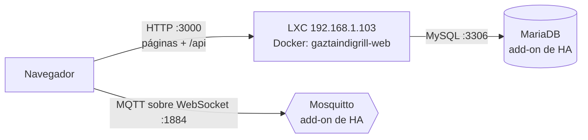

# Despliegue en el home lab

La web (páginas y API) corre como un contenedor Docker en un LXC de Proxmox, en
`http://192.168.1.103:3000`. MariaDB y Mosquitto siguen en Home Assistant y se alcanzan por la LAN.



El navegador habla con el broker directamente: el servidor solo le dice dónde está (`MQTT_*`).

## 1. Antes de empezar, en Home Assistant

1. **IP fija para Home Assistant.** Ahora la coge por DHCP y ya ha cambiado dos veces
   (`.76` → `.101` → `.102`). Fíjala en Ajustes → Sistema → Red → IPv4 → Estática, o con una reserva
   en el router. Si cambia, `DB_HOST` y `MQTT_HOST` dejan de apuntar a ella.
2. **Puerto 3306 de MariaDB expuesto**: add-on MariaDB → pestaña Red.
3. Cuando la web nueva funcione: desinstalar los add-ons **GaztaindiGrill API** y, si ya no sirve
   nada más, **Apache2**.

## 2. Crear el LXC en Proxmox

| | |
|---|---|
| Plantilla | Debian 12 o 13, **Unprivileged** |
| CPU | 2 cores |
| RAM | **3 GB** + 1 GB de swap mientras la imagen se construya aquí; 1 GB cuando la construya GitHub Actions |
| Disco | 10 GB en `local-lvm` |
| Red | IP estática `192.168.1.103/24`, puerta de enlace la del router |
| Options → Features | `nesting=1` y `keyctl=1` (sin ellos Docker no arranca dentro) |

`next build` con three.js necesita 1,5–2 GB de RAM; con 1 GB el build muere por falta de memoria.

## 3. Instalar Docker en el LXC

Entra en la consola del LXC (como root) y pega esto. Es el repositorio oficial de Docker, no el
paquete `docker.io` de Debian, que va con versiones atrasadas y sin el plugin de Compose.

```bash
apt update && apt install -y ca-certificates curl git
install -m 0755 -d /etc/apt/keyrings
curl -fsSL https://download.docker.com/linux/debian/gpg -o /etc/apt/keyrings/docker.asc
chmod a+r /etc/apt/keyrings/docker.asc
echo "deb [arch=$(dpkg --print-architecture) signed-by=/etc/apt/keyrings/docker.asc] https://download.docker.com/linux/debian $(. /etc/os-release && echo "$VERSION_CODENAME") stable" > /etc/apt/sources.list.d/docker.list
apt update && apt install -y docker-ce docker-ce-cli containerd.io docker-buildx-plugin docker-compose-plugin
docker run --rm hello-world
```

Si el último comando imprime "Hello from Docker!", está listo. Docker arranca solo con el LXC.

## 4. Primer despliegue

```bash
git clone https://github.com/izeta8/GaztaindiGrill.git /opt/gaztaindigrill
cd /opt/gaztaindigrill/GaztaindiGrill-NextJS
cp .env.example .env
nano .env        # DB_USER, DB_PASSWORD, MQTT_USER, MQTT_PASSWORD; revisa las IPs
docker compose up -d --build
docker compose ps   # tras unos 30 s, STATUS debe decir (healthy)
```

`.env` está en `.gitignore`: las credenciales viven solo en el servidor, nunca en la imagen ni en git.

## 5. Actualizar

```bash
cd /opt/gaztaindigrill && git pull
cd GaztaindiGrill-NextJS && docker compose up -d --build
docker image prune -f   # borra las imágenes viejas; el disco es pequeño
```

Cambiar solo una variable de `.env` no necesita build: `docker compose up -d` recrea el contenedor
con los valores nuevos.

## 6. Cuando algo falla

| Síntoma | Mira |
|---|---|
| La página no carga | `docker compose ps` y `docker compose logs -f web` |
| Los programas no cargan, `/api/programs` da 500 | El mensaje trae el error de MariaDB. `ECONNREFUSED` = IP de HA cambiada o 3306 sin exponer |
| La parrilla sale desconectada | `MQTT_HOST` y `MQTT_PORT` en `.env`; el broker tiene que aceptar WebSocket en 1884 |
| `unhealthy` en `docker compose ps` | `docker inspect --format '{{json .State.Health}}' $(docker compose ps -q web)` |
