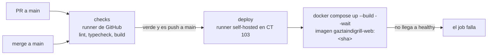

# Despliegue en el home lab

La web (páginas y API) corre como contenedor Docker en el CT 103 de Proxmox, en
`http://192.168.1.103:3000`. MariaDB y Mosquitto siguen en Home Assistant (`192.168.1.102`) y se
alcanzan por la LAN.

## Cómo funciona



| Pieza | Dónde |
|---|---|
| Workflow | `.github/workflows/web.yml` |
| Imagen | `Dockerfile` (multi-stage, `standalone`, `HEALTHCHECK` contra `/api/health`) |
| Contenedor | `compose.yml`, proyecto `gaztaindigrill`, servicio `web` |
| Variables (`DB_*`, `MQTT_*`) | `/etc/gaztaindigrill-web.env` en el CT (plantilla: `.env.example`) |
| Versión de Node | `.nvmrc` en el CI; `node:22-alpine` en el Dockerfile |

Cada despliegue construye la imagen en el CT con la etiqueta del commit (`gaztaindigrill-web:<sha>`)
y sustituye el contenedor; `latest` apunta siempre a la que corre. Mientras construye, la versión anterior sigue sirviendo. Las imágenes de
menos de 30 días se guardan para volver atrás.

## Montaje del CT 103 (una vez)

CT: Debian 12 o 13 sin privilegios, 2 cores, **3 GB de RAM** (`next build` con three.js necesita
1,5–2 GB), 10 GB de disco, IP fija `192.168.1.103/24`. En Options → Features, `nesting=1` y
`keyctl=1` (sin ellos Docker no arranca dentro).

Como root en el CT:

```bash
# 1. Docker desde su repositorio oficial (el docker.io de Debian va atrasado y sin Compose)
apt update && apt install -y ca-certificates curl git
install -m 0755 -d /etc/apt/keyrings
curl -fsSL https://download.docker.com/linux/debian/gpg -o /etc/apt/keyrings/docker.asc
chmod a+r /etc/apt/keyrings/docker.asc
echo "deb [arch=$(dpkg --print-architecture) signed-by=/etc/apt/keyrings/docker.asc] https://download.docker.com/linux/debian $(. /etc/os-release && echo "$VERSION_CODENAME") stable" > /etc/apt/sources.list.d/docker.list
apt update && apt install -y docker-ce docker-ce-cli containerd.io docker-buildx-plugin docker-compose-plugin
docker run --rm hello-world

# 2. Usuario del runner, con permiso para usar Docker
useradd --create-home --shell /bin/bash github-runner
usermod -aG docker github-runner

# 3. Variables: copia .env.example y rellena DB_USER, DB_PASSWORD, MQTT_* (en Bitwarden)
install -m 640 -o root -g github-runner /dev/null /etc/gaztaindigrill-web.env
nano /etc/gaztaindigrill-web.env
```

⚠️ Estar en el grupo `docker` equivale a ser root en el CT: por eso el job `deploy` nunca corre
con PRs y los PRs de fuera necesitan tu aprobación (abajo).

Runner:

1. GitHub → repo → Settings → Actions → Runners → **New self-hosted runner** → Linux x64.
2. En el CT, `su - github-runner` y pega los comandos de descarga y `./config.sh` que da GitHub.
   Cuando pregunte etiquetas, añade `homelab`.
3. `exit` (vuelve a root), y en la carpeta del runner: `./svc.sh install github-runner && ./svc.sh start`.
4. Comprueba que sale **Idle** en Settings → Actions → Runners.

En GitHub, antes del primer despliegue:

- Settings → Actions → General → **Require approval for all external contributors**.
- Primer despliegue: Actions → Web → **Run workflow** sobre `main`.
- Cuando `checks` haya corrido una vez: en el ruleset de `main`, **Require status checks to pass** con `Lint, typecheck and build`.

## Volver a una versión anterior

En el CT, desde la carpeta de trabajo del runner (`~github-runner/actions-runner/_work/GaztaindiGrill/GaztaindiGrill/GaztaindiGrill-NextJS`):

```bash
docker images gaztaindigrill-web                 # etiquetas = commits
IMAGE_TAG=<sha> docker compose up -d --wait
docker tag gaztaindigrill-web:<sha> gaztaindigrill-web:latest
```

Sin compilar: tarda lo que el arranque. El siguiente merge a `main` vuelve a desplegar lo último.

## Cuando algo falla

Los comandos `docker compose`, desde la carpeta de arriba.

| Síntoma | Mira |
|---|---|
| El job `deploy` no arranca | El runner sale «Offline» en Settings → Actions → Runners: `systemctl status 'actions.runner.*'` en el CT |
| `deploy` falla en `--wait` | `docker compose logs web`; el contenedor no llegó a `healthy` |
| El build muere en el CT | Falta RAM: 3 GB |
| Los programas no cargan, `/api/programs` da 500 | El mensaje trae el error de MariaDB. `ECONNREFUSED` = IP de HA cambiada o 3306 sin exponer |
| La parrilla sale desconectada | `MQTT_HOST` y `MQTT_PORT` en `/etc/gaztaindigrill-web.env`; el broker acepta WebSocket en 1884 |
| Cambié una variable | `docker compose up -d` (recrea el contenedor sin compilar) |
